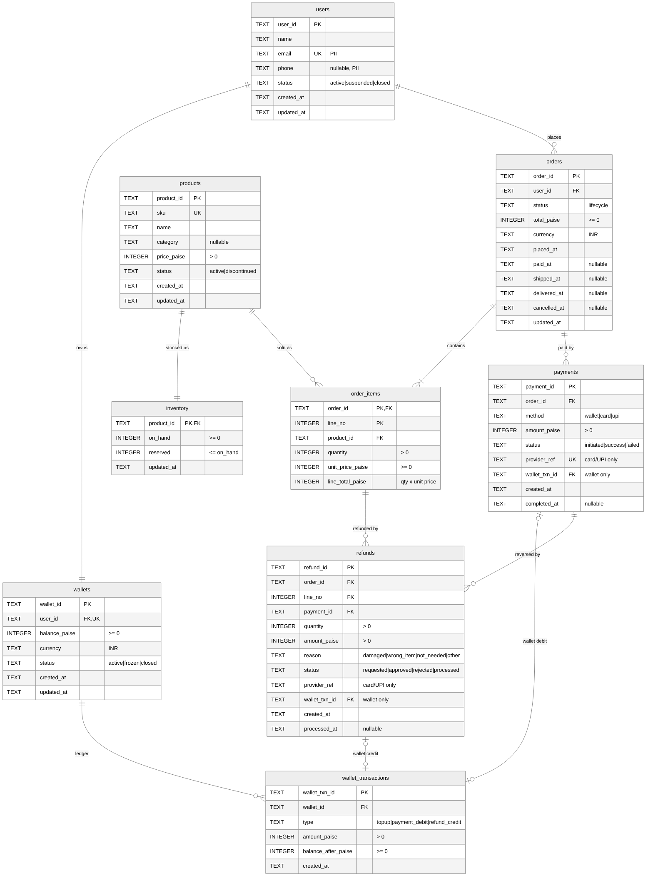

# Source Schema — E-commerce Orders (SQLite)

The source is the application's transactional database and the system of record.
Diagram source: [`docs/schema.mmd`](./docs/schema.mmd) (Mermaid; regenerate with
`mmdc -i docs/schema.mmd -o docs/schema.png -b white -s 2`).

**Conventions**
- Money is **integer paise** (SQLite has no exact decimal type); the warehouse converts to `DECIMAL(18,2)` rupees.
- Timestamps are ISO-8601 UTC text; the warehouse converts to `TIMESTAMP`.
- IDs are text; `PRAGMA foreign_keys = ON` for every connection.
- No card numbers, expiry dates or UPI handles are stored — only the payment gateway's reference.

---

## 1. Entities

| Table | Kind | Why it exists | Identity |
|---|---|---|---|
| `users` | Strong | Customer accounts | `user_id` |
| `products` | Strong | Sellable catalogue items | `product_id` |
| `wallets` | Strong | Stored balance, one per user | `wallet_id` |
| `orders` | Strong | A purchase and its lifecycle | `order_id` |
| `inventory` | Weak → `products` | Stock for a product; meaningless without it | `product_id` (parent key) |
| `order_items` | Weak → `orders` | Lines of an order | (`order_id`, `line_no`) |
| `payments` | Weak → `orders` | Each payment attempt (wallet, card, UPI); split payments and retries allowed | `payment_id`, always tied to an order |
| `wallet_transactions` | Weak → `wallets` | Append-only ledger of wallet money movement | `wallet_txn_id`, always tied to a wallet |
| `refunds` | Weak → `order_items` | Partial/full refund of a line, reversing part of a payment | `refund_id`, always tied to a line and a payment |

**Strong vs weak in this model:** a strong entity is created and lives on its own;
a weak entity cannot exist without its parent and is only ever created as part of the
parent's workflow (e.g. a line is created only while placing an order; a ledger entry
only through a wallet movement). `inventory` and `order_items` make the dependency
explicit by using the parent's key in their primary key.

**Lifecycle over deletion.** Users and wallets are never hard-deleted — they are
`closed` (a wallet's ledger must outlive it, and orders keep pointing at their user).
Primary keys never change once written (§6 S14), so every change event identifies the
same row for its whole life.

---

## 2. Columns and Constraints

`users`
| Column | Type | Null | Rules |
|---|---|---|---|
| user_id | TEXT | no | PK |
| name | TEXT | no | |
| email | TEXT | no | UNIQUE · PII |
| phone | TEXT | yes | PII |
| status | TEXT | no | `active` \| `suspended` \| `closed` |
| created_at | TEXT | no | |
| updated_at | TEXT | no | ≥ created_at |

`products`
| Column | Type | Null | Rules |
|---|---|---|---|
| product_id | TEXT | no | PK |
| sku | TEXT | no | UNIQUE |
| name | TEXT | no | |
| category | TEXT | yes | |
| price_paise | INTEGER | no | > 0 |
| status | TEXT | no | `active` \| `discontinued` |
| created_at, updated_at | TEXT | no | |

`inventory`
| Column | Type | Null | Rules |
|---|---|---|---|
| product_id | TEXT | no | PK, FK → products |
| on_hand | INTEGER | no | ≥ 0 |
| reserved | INTEGER | no | ≥ 0 and ≤ on_hand |
| updated_at | TEXT | no | |

`wallets`
| Column | Type | Null | Rules |
|---|---|---|---|
| wallet_id | TEXT | no | PK |
| user_id | TEXT | no | FK → users, UNIQUE |
| balance_paise | INTEGER | no | ≥ 0 |
| currency | TEXT | no | `INR` |
| status | TEXT | no | `active` \| `frozen` \| `closed` |
| created_at, updated_at | TEXT | no | |

`wallet_transactions`
| Column | Type | Null | Rules |
|---|---|---|---|
| wallet_txn_id | TEXT | no | PK |
| wallet_id | TEXT | no | FK → wallets |
| type | TEXT | no | `topup` \| `payment_debit` \| `refund_credit` |
| amount_paise | INTEGER | no | > 0 |
| balance_after_paise | INTEGER | no | ≥ 0 |
| created_at | TEXT | no | |

`orders`
| Column | Type | Null | Rules |
|---|---|---|---|
| order_id | TEXT | no | PK |
| user_id | TEXT | no | FK → users |
| status | TEXT | no | see §4 |
| total_paise | INTEGER | no | ≥ 0 |
| currency | TEXT | no | `INR` |
| placed_at | TEXT | no | |
| paid_at, shipped_at, delivered_at, cancelled_at | TEXT | yes | each ≥ placed_at |
| updated_at | TEXT | no | |

`order_items`
| Column | Type | Null | Rules |
|---|---|---|---|
| order_id | TEXT | no | PK part, FK → orders |
| line_no | INTEGER | no | PK part, ≥ 1 |
| product_id | TEXT | no | FK → products |
| quantity | INTEGER | no | > 0 |
| unit_price_paise | INTEGER | no | ≥ 0 |
| line_total_paise | INTEGER | no | = quantity × unit_price_paise |

`payments`
| Column | Type | Null | Rules |
|---|---|---|---|
| payment_id | TEXT | no | PK |
| order_id | TEXT | no | FK → orders |
| method | TEXT | no | `wallet` \| `card` \| `upi` |
| amount_paise | INTEGER | no | > 0 |
| status | TEXT | no | `initiated` \| `success` \| `failed` |
| provider_ref | TEXT | yes | card/UPI only; required on success; UNIQUE when present |
| wallet_txn_id | TEXT | yes | wallet only; required on success; FK → wallet_transactions |
| created_at | TEXT | no | |
| completed_at | TEXT | yes | ≥ created_at |

`refunds`
| Column | Type | Null | Rules |
|---|---|---|---|
| refund_id | TEXT | no | PK |
| order_id, line_no | TEXT, INTEGER | no | FK → order_items |
| payment_id | TEXT | no | FK → payments |
| quantity | INTEGER | no | > 0 |
| amount_paise | INTEGER | no | > 0 |
| reason | TEXT | no | `damaged` \| `wrong_item` \| `not_needed` \| `other` |
| status | TEXT | no | `requested` \| `approved` \| `rejected` \| `processed` |
| provider_ref | TEXT | yes | set when processed to card/UPI |
| wallet_txn_id | TEXT | yes | set when processed to wallet; FK → wallet_transactions |
| created_at | TEXT | no | |
| processed_at | TEXT | yes | ≥ created_at |

---

## 3. Relationships

| From | To | Cardinality | Notes |
|---|---|---|---|
| users | wallets | 1 : 1 | wallet created with the user |
| users | orders | 1 : N | |
| wallets | wallet_transactions | 1 : N | ledger |
| products | inventory | 1 : 1 | |
| products | order_items | 1 : N | |
| orders | order_items | 1 : N (≥ 1) | |
| orders | payments | 1 : N | split payments and retries |
| payments | wallet_transactions | 0..1 : 1 | wallet payments only |
| order_items | refunds | 1 : N | partial refunds |
| payments | refunds | 1 : N | refund goes back to the original method |
| refunds | wallet_transactions | 0..1 : 1 | wallet refunds only |

---

## 4. Status Lifecycles

Enforced in the source by `BEFORE UPDATE` triggers (`RAISE(ABORT)` on an illegal move).

    orders:   pending → paid → shipped → delivered → partially_refunded → refunded
              delivered → refunded
              pending → cancelled
              paid → cancelled            (payments refunded)
    payments: initiated → success | failed            (terminal states are final)
    refunds:  requested → approved → processed
              requested → rejected

### Inventory flow

| Event | `on_hand` | `reserved` | Guard |
|---|---|---|---|
| Restock | `+ n` | — | |
| Order placed | — | `+ qty` | `on_hand − reserved ≥ qty`, else the order is rejected |
| Order cancelled (pending/paid) | — | `− qty` | |
| Order shipped | `− qty` | `− qty` | |
| Refund | — | — | refunds do not restock; returned goods re-enter via an explicit restock |

So at any time `reserved = Σ quantity of lines on pending or paid orders` (S13).

---

## 5. Indexes

| Index | Supports |
|---|---|
| `users(email)` UNIQUE | login, duplicate-account prevention |
| `products(sku)` UNIQUE | catalogue lookup |
| `wallets(user_id)` UNIQUE | one wallet per user |
| `orders(user_id, placed_at)` | a user's order history |
| `orders(status)` | operational queues (to ship, to refund) |
| `order_items(product_id)` | product sales, inventory reconciliation |
| `payments(order_id)` | payments of an order |
| `payments(provider_ref)` UNIQUE, partial (`NOT NULL`) | idempotent gateway webhooks |
| `wallet_transactions(wallet_id, created_at)` | statements, balance replay |
| `refunds(order_id, line_no)` | refund cap per line |
| `refunds(payment_id)` | refund cap per payment |
| `change_log(seq)` PK, `change_log(txn_id)` | CDC reads from checkpoint; transaction grouping |

---

## 6. Invariants

| ID | Rule | Enforced in source by |
|---|---|---|
| S1 | Primary keys unique; foreign keys valid; NOT NULL columns set; enum values in domain | PK, FK, NOT NULL, CHECK |
| S2 | Amounts: prices, payments, refunds, ledger > 0; balances, totals ≥ 0 | CHECK |
| S3 | `line_total_paise = quantity × unit_price_paise` | CHECK |
| S4 | `0 ≤ reserved ≤ on_hand` | CHECK |
| S5 | Only allowed status transitions (§4) | BEFORE UPDATE triggers |
| S6 | Event timestamps not before creation (`paid_at ≥ placed_at`, `completed_at ≥ created_at`, …) | CHECK |
| S7 | Method consistency: wallet ⇒ `wallet_txn_id`, card/UPI ⇒ `provider_ref`, never both | CHECK |
| S8 | Wallet ledger is append-only | BEFORE UPDATE / DELETE trigger |
| S9 | `orders.total_paise = Σ order_items.line_total_paise` | write helper, same transaction |
| S10 | Paid (or later) orders: `Σ successful payments = total_paise` | write helper |
| S11 | Refunded quantity per line ≤ line quantity; refunded amount per payment ≤ payment amount | write helper |
| S12 | `wallets.balance_paise` = latest `balance_after_paise` = Σ credits − Σ debits | write helper |
| S13 | `inventory.reserved = Σ quantity` of lines on `pending`/`paid` orders | write helper |
| S14 | Primary keys are immutable; `users` and `wallets` are never deleted | BEFORE UPDATE / DELETE triggers |

S9–S13 span rows or tables, so — as in most real systems — they are enforced by the
application inside one transaction rather than by the database. The warehouse re-checks
all of S1–S14 (see README §8). Every rule ID is defined once in the rules
registry and a test fails if any rule lacks a warehouse check.

---

## 7. Expected Change Patterns

| Table | Pattern | Deletes |
|---|---|---|
| `orders` | insert, then frequent status updates | never (cancelled via status) |
| `inventory` | updated on every order, cancellation and restock | never |
| `payments` | insert, then one status update | never |
| `order_items` | insert with the order | yes — line removed before payment |
| `wallet_transactions` | insert only | never (trigger-enforced) |
| `refunds` | insert, then status updates | never |
| `wallets` | balance updates on every wallet movement | never (trigger-enforced; `closed` via status) |
| `users` | rare updates | never (trigger-enforced; `closed` via status) |
| `products` | rare updates | only if never ordered — deleted together with its `inventory` row in one transaction; otherwise `discontinued` |

---

## 8. CDC Support Tables (in the source)

These are not business tables and are not in the ER diagram; they exist so changes can
be captured inside the source's own transactions.

`change_log` — written only by triggers
| Column | Type | Meaning |
|---|---|---|
| seq | INTEGER | PK, AUTOINCREMENT; strictly increasing in commit order (rolled-back writes leave no gap) |
| txn_id | TEXT | id of the source transaction (see `_txn_context`) |
| schema_version | INTEGER | contract version baked into the trigger that wrote the event |
| table_name | TEXT | source table |
| op | TEXT | `insert` \| `update` \| `delete` |
| pk | TEXT | primary key as JSON |
| before | TEXT | row before the change as JSON; NULL on insert |
| after | TEXT | row after the change as JSON; NULL on delete |
| changed_at | TEXT | time of the write |

`_txn_context` — one row, set at the start of every write transaction
| Column | Type | Meaning |
|---|---|---|
| txn_id | TEXT | current transaction id (`T-<first seq>`); NULL outside a helper transaction |
| now | TEXT | the application clock's time for the transaction; NULL outside a helper transaction |

Write helpers run `BEGIN IMMEDIATE; UPDATE _txn_context SET txn_id = :new_id, now = :now; …business writes…;
UPDATE _txn_context SET txn_id = NULL, now = NULL; COMMIT`. Triggers read both columns, so every event of
one business operation shares a `txn_id` and a `changed_at` — and the injected (fake) clock reaches
the source, which keeps runs reproducible. A direct write that skips the helpers gets
`changed_at = strftime('%Y-%m-%dT%H:%M:%fZ','now')` and `txn_id = 'auto-' || seq` (assigned by a
trigger on `change_log`) — still unique, just not grouped.
