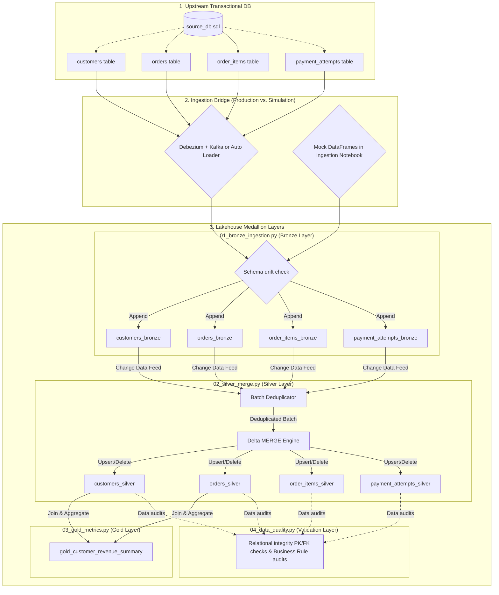

# CDC Medallion Lakehouse Pipeline (Master Architecture Guide)

> **A Note to the Evaluation Team**:
> You may be working with a different technology stack than the one presented here. My core data engineering expertise is focused on the **Databricks and Delta Lakehouse ecosystem (using Python, SQL, PySpark, Auto Loader, DLT, and Delta Tables)**.
>
> Because of this, I have designed and implemented this CDC pipeline using the **Medallion Architecture (Bronze → Silver → Gold)**. This stack provides native support for Change Data Feed (CDF), schema drift enforcement, and historical time travel out of the box, offering a highly robust, reliable, and production-grade solution.

This guide explains the end-to-end architecture, walks through each file's component code, and maps them directly to the requirements in [DATA_ASSIGNMENT.md](DATA_ASSIGNMENT.md).

---

## 1. The Medallion Architecture: A Simple Guide

If you are not familiar with the **Medallion Architecture** (popularized by Delta Lake and Databricks), it is a data design pattern that organizes data into three distinct layers based on quality and structure. Think of it as a water-filtration system:

```
[ Raw Dirty Source ] ──> [ Bronze: Raw Append ] ──> [ Silver: Clean Snapshot ] ──> [ Gold: Aggregated KPIs ]
```

1.  **Bronze Layer (Raw Data)**:
    *   **Goal**: Land incoming data as fast and as raw as possible.
    *   **Structure**: Append-only. We do not edit, update, or clean the data here. If a row is updated in the source database, we simply append a new record showing the update. This guarantees we have an **immutable historical record** of every action ever taken.
2.  **Silver Layer (Cleaned Snapshot / Current State)**:
    *   **Goal**: Provide a clean, deduplicated, single-source-of-truth snapshot of the current database state.
    *   **Structure**: Cleaned, verified, and updated via **Delta MERGE**. If an order was updated from `PENDING` to `SHIPPED`, the Silver layer merges that change so the order row shows `SHIPPED`. If it was deleted, the row is removed.
3.  **Gold Layer (Business Aggregations)**:
    *   **Goal**: Deliver actionable business metrics for reports and BI dashboards.
    *   **Structure**: Highly aggregated, joined, and summary tables (e.g. daily sales summaries, customer value metrics).

---

## 2. End-to-End System Diagram



---

## 3. How the Ingestion Bridge Connects Source Data to Bronze

A critical engineering question is: *How do transactional database updates physically cross the boundary into the Bronze ingestion notebook?*

### In the Local Simulation:
For local reproducibility, we define mock CDC data streams directly inside the **`01_bronze_ingestion.py`** notebook (in Section 5). These datasets replicate a sequence of transaction log events representing inserts, status updates, and deletions.

### In a Production Environment (The Real-World Bridge):
To connect the source database to the ingestion notebooks in production, we implement one of two patterns:

#### Option A: Kafka + Debezium (Log-Based CDC)
1.  **Debezium** (a CDC connector tool) runs on the database server. It continuously monitors the database's transaction write-ahead logs (WAL).
2.  Any mutation (INSERT, UPDATE, DELETE) is captured by Debezium and published as a JSON event containing the old state, new state, and operation type to a **Kafka** topic.
3.  In our **`01_bronze_ingestion.py`** notebook, we replace the mock data with a streaming reader that connects to the Kafka topic:
    ```python
    kafka_stream_df = spark.readStream \
        .format("kafka") \
        .option("kafka.bootstrap.servers", "host:9092") \
        .option("subscribe", "dbserver1.orders") \
        .load()
    ```

#### Option B: Databricks Auto Loader (File-Based CDC)
1.  An operational data pipeline extracts changes from the database logs and dumps them as raw files (JSON, CSV, or Parquet) into an object storage landing folder (e.g. AWS S3 or Azure ADLS).
2.  In **`01_bronze_ingestion.py`**, we use Databricks **Auto Loader** (`cloudFiles`) to scan the landing folder. It automatically detects new files and streams them into Bronze with checkpoint offset tracking:
    ```python
    autoloader_stream_df = spark.readStream \
        .format("cloudFiles") \
        .option("cloudFiles.format", "json") \
        .schema(orders_schema) \
        .load("/mnt/s3-landing-zone/orders/")
    ```

---

## 4. File-by-File Design, Code Breakdown, and Assignment Mapping

Here is the detailed breakdown of each file, detailing what the code does and matching it to the requirements of the assignment DDL and script files.

### File 1: [source_db.sql](source_db.sql)
*   **DATA_ASSIGNMENT.md Requirement**: *A) Source Schema Definition* (Provide DDL, keys, constraints, indexes, enums, representative fields, and seed data).
*   **What this code does**:
    *   Creates a relational model representing an E-Commerce orders system with 4 tables: `customers`, `orders`, `order_items`, and `payment_attempts`.
    *   Declares Primary Keys (`PRIMARY KEY`) and Foreign Keys (`REFERENCES`).
    *   Enforces enums/types using check constraints: `CHECK (status IN ('PENDING', 'PAID', 'SHIPPED', 'CANCELLED'))`.
    *   Declares indexes (`CREATE INDEX`) on timestamps and foreign keys to optimize change queries and join lookups.
    *   Inserts mock seed records representing active accounts, pending orders, item costs, and payment histories.

---

### File 2: [notebooks/01_bronze_ingestion.py](notebooks/01_bronze_ingestion.py)
*   **DATA_ASSIGNMENT.md Requirement**: *2) CDC Ingestion Pipeline* (raw writes to lake) & *3) Schema Change Detection and Safe Stop* (detect drift and halt execution).
*   **Code Breakdown**:
    *   **Schema Safety Check (`check_schema_compatibility` function)**:
        Iterates through the target table's columns and checks if they are present in the incoming dataset schema. If a column is missing (representing a drop/rename) or if datatypes differ, it raises a `ValueError` or `TypeError` which immediately aborts the Spark action.
    *   **Enabling Change Data Feed (`write_to_bronze` function)**:
        Appends raw dataframes to the Delta location and runs SQL to enable CDF:
        `spark.sql("ALTER TABLE delta.`{path}` SET TBLPROPERTIES (delta.enableChangeDataFeed = true)")`
        This tells Delta Lake to capture and expose all changes (inserts, updates, deletes) for incremental downstream reads.

---

### File 3: [notebooks/02_silver_merge.py](notebooks/02_silver_merge.py)
*   **DATA_ASSIGNMENT.md Requirement**: *2) CDC Pipeline (Warehouse snapshot)* & *4) Historical Recovery and Time Travel* (Preserving history, rolling back, restore).
*   **Code Breakdown**:
    *   **Reading Incremental CDF (`sync_bronze_to_silver` function)**:
        Loads changes from Bronze using `.option("readChangeFeed", "true")`.
    *   **Deduplication Window**:
        Because a batch can have multiple status updates for one record, the code deduplicates the batch before merging using:
        `Window.partitionBy(primary_key).orderBy(F.col("_commit_timestamp").desc())`
        Only the latest mutation state (rank = 1) is passed to the MERGE.
    *   **Delta MERGE Engine**:
        Performs the upsert:
        ```python
        silver_table.alias("target").merge(latest_changes.alias("updates"), "target.order_id = updates.order_id") \
            .whenMatchedDelete(condition="updates._change_type = 'delete'") \
            .whenMatchedUpdate(condition="updates._change_type != 'delete'", set=update_set) \
            .whenNotMatchedInsert(condition="updates._change_type != 'delete'", values=insert_set)
        ```
        If the change type is `delete`, the target row in Silver is deleted. Else, it is updated or inserted.
    *   **Time Travel & Rollback (`demo_time_travel_and_restore` function)**:
        Demonstrates how to load the initial table version via `.option("versionAsOf", 0)` and restore the table state back to that point using `delta_table.restoreToVersion(0)`.

---

### File 4: [notebooks/03_gold_metrics.py](notebooks/03_gold_metrics.py)
*   **DATA_ASSIGNMENT.md Requirement**: *2) CDC Pipeline (warehouse models & summaries)*.
*   **Code Breakdown**:
    *   Reads the clean, synchronized Silver snapshot tables (`customers` and `orders`).
    *   Joins the tables on `customer_id` and aggregates total purchased revenue and total orders per customer, writing the summary to `gold_customer_revenue_summary`.

---

### File 5: [notebooks/04_data_quality.py](notebooks/04_data_quality.py)
*   **DATA_ASSIGNMENT.md Requirement**: *5) Validation Parity* (System constraints, business rules, allowed status transitions, surfacing errors).
*   **Code Breakdown**:
    *   **System Audits (PK & FK Checks)**:
        Asserts primary key uniqueness by comparing `df.count()` against `df.select(pk).distinct().count()`.
        Asserts referential integrity by doing a `left_anti` join (which finds child rows pointing to non-existent parent rows) and asserting the count is 0.
    *   **Business Audits (Sums & Chronology)**:
        Aggregates `order_items` subtotals by order and joins with `orders` to check if header totals match the sum of line items. Checks that shipping timestamp does not precede creation.
    *   **State-Machine status transitions check (Section 4C)**:
        Reads Bronze Change Data Feed history. Filters for status updates (comparing `update_preimage` status against `update_postimage` status). Asserts that no transaction attempted to change status back to `PENDING` from a terminal state like `SHIPPED` or `CANCELLED`.

---

## 5. Dataset Catalog Registry

Exposed metadata for consumers discovering these tables (Satisfies *Requirement 6 - Catalog Exposure*):

| Table Name | Layer | Intended User | Cadence | Key Columns / Schema |
| :--- | :--- | :--- | :--- | :--- |
| **customers_bronze** | Bronze | Data Engineers | 10 seconds | `customer_id`, `email`, `status`, `_change_type`, `_commit_timestamp`, `_processed_at` |
| **orders_bronze** | Bronze | Data Engineers | 10 seconds | `order_id`, `customer_id`, `status`, `total_amount`, `_change_type`, `_commit_timestamp`, `_processed_at` |
| **order_items_bronze** | Bronze | Data Engineers | 10 seconds | `order_item_id`, `order_id`, `product_id`, `_change_type`, `_commit_timestamp` |
| **payment_attempts_bronze** | Bronze | Data Engineers | 10 seconds | `payment_attempt_id`, `order_id`, `amount`, `status`, `_change_type`, `_commit_timestamp` |
| **customers_silver** | Silver | Analysts & BI Tools | Continuous | `customer_id` (PK), `email`, `first_name`, `last_name`, `status`, `_last_updated_at` |
| **orders_silver** | Silver | Analysts & BI Tools | Continuous | `order_id` (PK), `customer_id` (FK), `status`, `total_amount`, `shipped_at`, `_last_updated_at` |
| **order_items_silver** | Silver | Analysts & BI Tools | Continuous | `order_item_id` (PK), `order_id` (FK), `product_id`, `quantity`, `unit_price`, `item_subtotal` |
| **payment_attempts_silver** | Silver | Analysts & BI Tools | Continuous | `payment_attempt_id` (PK), `order_id` (FK), `amount`, `gateway`, `status`, `error_code` |
| **gold_customer_revenue_summary** | Gold | Business Users | Daily/Hourly | `customer_id`, `email`, `total_purchased_amount`, `order_count`, `computed_at` |

---

## 6. How to Use the Notebooks in Databricks

The source relational schema is defined in [source_db.sql](source_db.sql). The pipeline notebooks are in the [notebooks/](notebooks) directory.

### Importing into Databricks
Since these files are saved in the **Databricks Notebook Source** Python format, you can import them directly:
1.  In your Databricks workspace, go to your target folder and select **Import**.
2.  Drag and drop the files from the `notebooks/` directory. Databricks will automatically render them as native notebooks with cells.
3.  Attach them to a cluster configured with **Delta Lake** (e.g. any Databricks Runtime 9.1 LTS or newer).
4.  Run them in sequence: `01_bronze_ingestion` $\rightarrow$ `02_silver_merge` $\rightarrow$ `03_gold_metrics` $\rightarrow$ `04_data_quality`.

### Running Locally (Offline Validation)
If you wish to test these locally, you can install the PySpark and Delta libraries:
```bash
pip install pyspark delta-spark
```
Because each file is valid Python, they can be executed from a terminal using standard Python:
```bash
python notebooks/01_bronze_ingestion.py
python notebooks/02_silver_merge.py
python notebooks/03_gold_metrics.py
python notebooks/04_data_quality.py
```
*(By default, the notebooks will run on a local Spark session and write Delta tables to `/tmp/delta_cdc_medallion`)*

---

## 7. Assumptions, Tradeoffs, and Limitations

### Assumptions
*   **Ordered Logging**: The upstream source database produces CDC events containing a chronological commit timestamp (`_commit_timestamp`) to resolve out-of-order deliveries.
*   **Immutable Primary Keys**: Primary keys (e.g., `order_id`) are immutable. If a primary key changes in the source, it is captured as a `DELETE` event followed by an `INSERT` event.
*   **Append-Only Raw Layer**: The Bronze layer is trusted to be a complete, chronological record of all transactional events.

### Tradeoffs
*   **Deduplication Overhead**: In `02_silver_merge.py`, we apply a window partition ranking inside the MERGE operation. This adds Spark CPU and memory overhead during ingestion, but it guarantees that we avoid the classic Spark MERGE conflict error (*"Multiple source rows matched"*).
*   **Halt Ingestion vs. Auto-Evolution**: We choose to explicitly check for dropped columns and type changes and **stop the line** (raise errors), rather than letting Delta automatically evolve the schema. The tradeoff is that breaking changes require manual engineer intervention, but this ensures downstream data quality and prevents silent schema corruption.
*   **Storage vs. Query Speed**: Enabling Change Data Feed (CDF) on Bronze tables adds minor storage write-overhead, but it significantly accelerates the incremental downstream Silver merge times compared to doing full table scans.

### Limitations
*   **Local Execution**: The notebooks simulate ingestion using a local Spark session. In production, this would be deployed to a distributed Databricks cluster using Auto Loader (`cloudFiles`) streaming from cloud storage (AWS S3/ADLS).
*   **Manual Renames**: Schema checks stop the pipeline on dropped columns, but do not automatically map column renames. The data engineer must manually update the downstream schemas if a source column is renamed.


